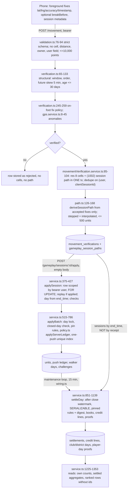

# Server authority and adversarial location invariants (B4)

Research artifact, Track B section B4. Base: `feat/g34-server-holdings` at cb27318. Nothing here changes product source. Gameplay stays off unless `MOVENRUN_GAMEPLAY_ENABLED` is set. Rule set 1001 is the default. Rule set 1002 is an unratified simulation-pilot proposal and is not live. Every route and place below is synthetic planar geometry around a fixed origin. No request went to any live API, testnet or hosted database.

Evidence tiers: **SOURCE** (V3 PDF), **OWNER DECISION**, **PILOT ASSUMPTION**, **VERIFIED CODE** (read at cb27318 and/or exercised by a fixture; file:line given), **SYNTHETIC EXPERIMENT** (seeded sweep), **HOSTED PROOF** (none: there was no live observation).

## How to reproduce

From `movenrun/`:

```
# Default suite: 19 pure tests run, 7 PostgreSQL tests skip cleanly
node --import tsx --test 'research/economy-redteam/invariants/**/*.test.ts'

# Full suite on a throwaway local PostgreSQL 16 (never a hosted database)
MOVENRUN_TEST_DATABASE_URL=postgresql://postgres@127.0.0.1:<port>/postgres \
  node --import tsx --test 'research/economy-redteam/invariants/**/*.test.ts'

# Seeded sweeps written to research/economy-redteam/invariants/out/
node --import tsx research/economy-redteam/invariants/run.ts
```

Results at writing: with the database, 26 of 26 tests pass. Without it, 19 pass and 7 skip. The full suite runs in about 4 s. The PostgreSQL tests use the backend's own harness, `backend/src/gameplay/pgTestDb.ts`, which creates a database, applies migrations 0000–0010 plus the proposed 0011 revision 3, and drops the database afterwards. The local cluster was made with `initdb` + `pg_ctl` on 127.0.0.1, on a port other than the default, and deleted after the run.

Files are in `research/economy-redteam/invariants/`:

- `boundary.test.ts`: pure invariants covering the API, path, gaps, bounds, once-per-day, version, watermark, proofs and capacity.
- `invariants.pg.test.ts`: SQL invariants covering injection, end-to-end interpolation, idempotency, once-per-day through the service, the settlement watermark, proofs and refusals.
- `sweep.ts`, `run.ts`, `sweep.test.ts`, `manifest.json`, `out/*.csv`: seeded sweeps and a test that the same seed gives byte-identical output.
- `helpers.ts`: geometry, PRNG and a restatement of the player-day proof digest. The PostgreSQL test checks this restatement against the stored digest.

A test whose name starts with "documents defect", "documents gap", "documents limitation" or "requires ratification" passes **because** it shows the problematic behaviour is present.

## 1. Trusted-data boundary



| Stage | Who controls the input | What the server derives | Code (cb27318) |
|---|---|---|---|
| Foreground observations | Client: coordinates, accuracy, timestamps, `breakBefore`, metadata | Nothing yet | `backend/src/movement/http/validation.ts:27-94` |
| Accepted fixes | Server rules over client data | Accept or reject the **whole** session. No per-fix filtering is stored | `movement/domain/verification.ts:141-189`, `shared/src/domain/measurement.ts:27-59` |
| Session dedupe | Server (DB unique index plus conflict re-read) | One row per (user, client session id). Metadata conflicts fail closed | `movement/services/movementVerification.service.ts:68-123` |
| Server-minted step evidence | Server only | Res 8 cells (1001); res 10 path with an interpolated bit per unit (1002) | `movement/http/productionRouter.ts:56-58`, `gameplay/path.ts:109-178`, `movement/repositories/drizzle/store.ts:44-51` |
| Push / challenge | Server only. The client names a session id and nothing else | `solid` push events, ledger, take budget, unit budget, 20 h second-push guard by server receipt | `gameplay/router.ts:34,76-82`, `gameplay/service.ts:375-427, 515-786`, `gameplay/policy.ts:132-205` |
| Credit settlement | Server only, after the watermark | Holdings at close, credits, clubs, districts, proofs | `gameplay/service.ts:835-1139`, `rules.ts:410-412` |
| Public aggregates | Server only | Counts, settled-day aggregates, ranks without ids | `gameplay/service.ts:1225-1353` |

## 2. Threat table

| # | Threat | Control found | Result |
|---|---|---|---|
| T1 | Fabricated H3 cells or ownership/balance deltas in a request | Strict schemas, user taken from the bearer | PASS |
| T2 | Route interpolation counted as footstep (1002) | `pushInterpolated: true` | **RATIFICATION REQUIRED** (§4.1) |
| T3 | GPS jump bridging beyond the limits | Continuity limits of 200 m, 120 s, 12 m/s, break, pause | PASS |
| T4 | Off-route straight-line cells | Same as T2 | RATIFICATION (constructed case only; the seeded sweep did not reproduce it) |
| T5 | Fake "cellular" speed of 12–22 m/s | Path stops interpolating above 12 m/s; the on-foot fix policy rejects above 12 m/s | PASS for the path; see limitations |
| T6 | Device clock ahead or behind | Future skew of 5 min; day closed after 2 h grace; second push by server receipt | PASS for pushes; **DEFECT** for settlement (§4.2) |
| T7 | Same account, several phones at once | Row locks, one-push unique index, walker-day row lock | PASS |
| T8 | Duplicate finalisation / replay of apply | `gameplay_applied_sessions` unique on movement id; FOR UPDATE | PASS |
| T9 | Cross-account session injection | Lookup by (bearer user, session id); `mv:` keys only through `applySession` | PASS |
| T10 | Path array bounds / huge sparse coverage | 10,000 points; path ≤ 500 units, truncated in walk order; DB check ≤ 500; 1001 `too_many_units` | PASS |
| T11 | Wrong rules version or digest (1002 vs 1001) | `rulesetFor` throws; day pinned with a digest; season keeps one rule set | PASS |
| T12 | Settlement before the close watermark | `day_not_closed` | PASS |
| T13 | Edit / replay / reorder of retained ledger | Append-only ledger, final credit lines, player-day sha256 | PASS for edit and reorder; **LIMITATION** for proof integrity (§4.3) |
| T14 | Exceeding a 200-player target silently | None | **GAP** (policy not approved) (§4.4) |
| T15 | Refusal leaving half-state or credit leakage | One transaction per apply; guard checked before writes | PASS |
| T16 | Joint fake households, low-end devices | Not a boundary control; see B6 | NOT TESTABLE OFFLINE here |

## 3. Invariant results

Hypotheses H1–H5 were written in `manifest.json` before the sweeps ran.

| Invariant | Result | Evidence | Fixture |
|---|---|---|---|
| A client cannot submit cells, distance, owner, user, credits or outcomes | **PASS** | VERIFIED CODE: `validation.ts:76-94` is `.strict()`, and so is the gameplay apply body (`router.ts:34,79`). Ten smuggled fields were each refused. Over HTTP, six forbidden bodies got 400 and an unknown bearer got 401 before the service was called. The service saw exactly `(bearer user, session id)` | boundary.test.ts "API: …" (2 tests) |
| The path comes only from verified fixes | **PASS** | VERIFIED CODE `path.ts:126-168`. Seeded fuzz over 8 seeds × 25 walks: units are unique and ≤ 500; a unit is "stepped" exactly when it holds a fix; the stored flag bits round-trip, and a corrupt bit string throws. The end-to-end PostgreSQL test checks the stored path equals `deriveSessionPath` of the accepted observation | boundary "path: …"; pg "requires ratification: a real verified walk …" |
| Non-canonical cells cannot be stored | **PASS** | `cells.ts:16-24`; DB check `0011:160` | boundary "cellToInt8" |
| Unresolved GPS gaps outside the limits add nothing | **PASS** | `path.ts:109-118`: break, pause, 201 m, 121 s and 12.9 m/s each give 0 interpolated units and 1 skipped segment | boundary "gaps outside …" |
| Gaps **inside** the limits never yield Solid / toll / deed eligibility | **FAIL against A1; RATIFICATION REQUIRED** | See §4.1. Toll: PASS, because `steppedUnitsOf` excludes interpolated units (`service.ts:962-986`). Deeds: the server never sets `deeded`, so there is no deed issuance path to test | boundary "requires ratification: …bridged 120 s"; pg end-to-end |
| Off-route sampled cells cannot be scored | **RATIFICATION REQUIRED (constructed case)** | An 80 m + 80 m corner with fixes only at its two ends (115 s) pushes 1 unit that lies on the chord, not the route. With a fix every 10 s it pushes 0. SYNTHETIC EXPERIMENT: H3 was **not supported**. Five seeded random right-angle walks pushed 0 off-route units at every fix interval from 5 s to 100 s. Sparse fixes lowered recall instead (for example 6 → 3 units, `out/sparse_walk_sweep.csv`) | boundary "…corner…"; sweep.test.ts |
| Idempotency under duplicate finalisation | **PASS** | VERIFIED CODE `service.ts:379-394`, `0011:482`. Ten concurrent applies of one session gave exactly 1 non-replayed result and 5 eroded pushes | pg "idempotency …" |
| Two phones at once | **PASS** | Two different sessions of one walker over the same 5 units, applied concurrently: every unit has exactly 1 ledger row; both later sessions are `refused_daily_limit`. Takes used = 5; units used = 15 (the capacity budget counts refused units, as documented at `policy.ts:100`) | pg "idempotency …" |
| Once per walker per unit per day survives a flip | **PASS** | Model (`holding.ts:244-246`) and service (`service.ts:605-644`; unique index `0011:283-285`). Under 1001: taker flips, holder flips back, taker is refused. A third walker's second push and the holder's third push are refused | boundary + pg "once per day …" |
| …and survives a challenge reset | **PASS** | Under 1002: the holder's answer clears the challenge (`holding.ts:237`) but not the challenger's push of the day (`refused_daily_limit`). The next day opens a **new** challenge rather than flipping; the flip comes on the following day, 25 h by server receipt. After the flip the old holder can push once, then is refused | boundary + pg "once per day …" |
| Wrong rules version or digest fails closed | **PASS** | `rules.ts:293-297,420-431`, `service.ts:794-825,886-892`. Unknown or malformed versions throw. Five single-field config changes each move the digest. A 1001 service on a 1002-pinned day gets `rules_version_mismatch` and writes nothing. An unknown path rule version is a rule problem; a stored path under another version gets `session_path_version_mismatch` (covered by the existing test `gameplayRules.pg.test.ts:300`) | boundary "wrong rules …"; pg "refusal …" |
| Settlement cannot count a day before its watermark | **PASS** | `service.ts:853`, `rules.ts:410-412`: `day_not_closed` at 01:54; the boundary is exact at midnight + 2 h | boundary "watermark …"; pg "documents defect …" |
| Settlement counts only evidence received before the watermark | **DEFECT** | See §4.2 | pg "documents defect: settlement credits a session …" |
| Retained player-day proofs detect edit / replay / reorder | **PASS for edit, reorder, duplicate and drop; LIMITATION for replay and tamper-resistance** | See §4.3. The restated digest equals the stored one on PostgreSQL | boundary "proofs …", "documents limitation …"; pg "proofs …" |
| The 200-user target cannot be exceeded silently | **GAP (not approved policy)** | See §4.4 | boundary "documents gap: nothing caps players …" |
| Capacity guard fails closed | **PASS** | `capacity.ts:361-417,454-482`: NaN, negative or infinite size, or bad thresholds → hard stop with factor 0. In the service, a stop or a throwing guard → 503 and no write | boundary "capacity guard …"; pg "refusal …" |
| A refusal leaves no half-state or credit leakage | **PASS** | Nine refusal paths, with a full snapshot (row counts of every `gameplay_*` table, walker-day counters, md5 of unit holders and strengths) taken before and after each, were all unchanged: `unit_resolution_mismatch`, `session_path_unavailable`, `capacity_hard_stop` ×2, `session_not_verified`, `session_in_future`, `day_closed`, `rules_version_mismatch`, `too_many_units`. A refused session applies normally later, exactly once | pg "a refusal leaves no half-state …" |
| Path array bounds / huge sparse coverage | **PASS** | 2,000 fixes over about 100 km → exactly 500 units, `truncated: true`. A path cap above `maxUnitsPerSession` is a rule problem. More than 10,000 points is refused by the schema. Segment > 200 m or speed > 12 m/s is a path-rule problem | boundary "bounds …" |
| Cross-account session injection | **PASS** | `service.ts:379-383` scopes by bearer user, so another user's id gives `session_not_found`. A forged `mv:<other id>:<unit>` event through `applyPushes` is `invalid_event` before the owner applies and `skipped` after. The forger has no ledger row | pg "cross-account …" |

SYNTHETIC EXPERIMENT, `out/segment_sweep.csv`: across 5 seeds × 400 single gaps (20–200 m, 0.8–2.5 m/s, ≤ 120 s), all 400 per seed were walkable and 100–117 per seed (25–29%) produced at least one interpolated, pushed unit. H1 is supported.

## 4. Findings needing action

### 4.1 Interpolated units push as solid ground under 1002 (RATIFICATION REQUIRED)

- **What happens (VERIFIED CODE).** `VERIFIED_STEPS_V1.pushInterpolated = true` (`path.ts:73`). `applySession` turns every unit of `pushUnitsOf` into `{ kind: "solid" }` (`service.ts:402,411`). An interpolated unit therefore:
  - claims at strength 100;
  - reinforces and refreshes the decay of the walker's own ground;
  - erodes or flips other walkers' ground;
  - counts as a zone visit (`service.ts:750-765`);
  - counts toward club contributions and district control.
- **Reproduced end to end on PostgreSQL.** A walk verified by the real pipeline, with a 180 m / 120 s gap (1.5 m/s), stores two interpolated units. 1002 pushes both. One of them was another walker's 29-day-unvisited ground at strength 13, and it is **flipped** to the walker at 87.
- **Conflicts.**
  - SOURCE V3 §4 calls Solid "cells you physically moved through" / "ground you actually stepped on" (glossary).
  - Repo ASSUMPTION A1 (`docs/GAME_ECONOMY_V3.md:319,330`): "Inferred cells never claim, defend, toll or count traffic; G2 must enforce".
  - `shared/src/domain/holding.ts:18-19`: interpolated cells "must not be passed in as solid pushes".
  - The `applySession` docstring (`service.ts:371-373`) says the opposite of what 1002 does: "never cells inferred between fixes".
  - The departure is documented as awaiting an owner decision in `docs/G34_SERVER_ARCHITECTURE.md:170,230,359`.
- **Not a defect in 1001,** which pushes only fix-containing res 8 cells.
- **Recommendation for the integration owner.** Before 1002 can be ratified, record an explicit owner decision on D5 / A1. Then do one of the following:
  1. Ship a rule set with `pushInterpolated: false`. The switch already exists, passes `sessionPathRuleProblems`, and changes the digest, so it would be a new holding rules version, not an edit of 1002.
  2. If interpolation must push, push interpolated units as a weaker, non-Solid kind (never flip, never claim at 100) and exclude them from zone visits and district weight.

  Either way, correct the `service.ts:371-373` docstring.

### 4.2 Settlement credits sessions received after the close watermark (DEFECT)

- **Reproduction:** `invariants.pg.test.ts`, test "documents defect: settlement credits a session …".
- **What the fixture shows.** Ben's session ends at 20:00 on day X, and the server receives it at 03:00 on X+1, after the close at 02:00. `applySession` refuses it (`day_closed`). The settlement that runs later still writes Ben a credit line with earned > 0. The same upload on day Y, where maintenance happened to settle first, gets nothing, permanently. Credits therefore depend on when the 15-minute maintenance loop ran. A sleeping free instance makes that window hours long.
- **Cause (VERIFIED CODE).** The settlement reads sessions by `end_time` and status only (`service.ts:955-958`), never by server receipt `created_at`. The movement pipeline accepts sessions up to 30 days old (`verification.ts:52`), against a 2 h gameplay grace. The client controls `end_time` within that window. So:
  - a backdated session can be steered into any unsettled day;
  - backdated sessions on the six previous days can raise `activeDaysThisWeek` (the consistency multiplier, ×1.0 to ×1.5, `economyV3.ts:165-173`) for the current day. The pool is far from binding at pilot scale, so this second effect could not be observed with a handful of players. It is stated as a mechanism, not a measured effect.
- **Recommended patch (do not apply here).**
  1. In `settleInTx`, count a session for day `d` only if `created_at < dayStartMs(d+1) + dayCloseGraceMs`.
  2. Count a session toward the active-day set for day `k` only if it was received before `k`'s close.
  3. Add the receipt bound to `input_digest` so a re-settlement is reproducible.
  4. Add a regression test that mirrors this fixture and expects no credit line.

### 4.3 Player-day proofs: what they do and do not prove (LIMITATION)

- **What works (VERIFIED CODE).** `events_sha256` (`service.ts:1105-1135`) is sha256 over a walker's accepted rows in `seq` order plus one refusal line. It detects an edited, reordered, duplicated or dropped row and a changed refusal counter. The restatement in `helpers.ts` equals the stored value on PostgreSQL. The ledger is append-only (`0011:295-319`) and credit lines and settlements are final (`0011:646-650`); UPDATE gets SQLSTATE 23001.
- **What it does not do:**
  - (a) The digest binds neither the day nor the player, so identical rows replayed under another key hash the same. Only the primary key (`player_no, day`) ties them together.
  - (b) It is an unkeyed hash, not a MAC or signature. Anyone holding the rows can recompute it.
  - (c) Proofs are not chained across days, so deleting a whole player-day (its proof and its archived rows) is undetectable from the proofs.
  - (d) `gameplay_player_day_proofs` has **no** final or append-only trigger. The fixture rewrites a stored digest with a plain UPDATE (1 row).
  - (e) Credit lines are not covered by the player proof. `input_digest` covers settlement inputs, not outputs.

  `docs/G34_STORAGE_CAPACITY.md:161` ("prove the archive was not altered") holds only against someone who cannot also write the proof table.
- **Recommendation:**
  1. Add a final trigger to the proof table, as for credit lines.
  2. Include day, player number and rules version in the hashed text.
  3. Chain each day's proofs into a per-day root stored in `gameplay_day_settlements`.
  4. Export that root off-database (an owner-held record) when partitions are archived.

  None of this needs any chain activity.

### 4.4 No player cap; storage guard off by default (GAP, policy not approved)

- **What the code does (VERIFIED CODE).** No code caps the number of players at 200 or any other number. `gameplay_players` rows are created on the first push of any authenticated user (`service.ts:346-363`). The capacity guard exists only when `MOVENRUN_GAMEPLAY_CAPACITY_QUOTA_MIB` is set (`wiring.ts:39-46`, `capacity.ts:495-508`). Otherwise the only bound is the per-walker unit budget of 300 a day.
- **What that means.** If a 200-player quota is approved later, the current build would exceed it **silently**.
- **Status of the numbers.** The figure of 200 and the 60/75/85% tripwires are PILOT ASSUMPTIONS, not ratified policy.
- **Recommendation, if a quota is approved:**
  1. Add an admission check at first `gameplay_players` insert, counted in the same transaction under an advisory lock, that fails closed with a distinct code.
  2. Expose the current count to the operator.
  3. Make gameplay refuse to start when enabled without a confirmed storage quota.

## 5. Limitations

- **One-day apply window.** Device clock attacks are tested only to the extent the structure allows. A session dated up to 30 days back passes the movement pipeline (`verification.ts:52`). Gameplay then bounds the push day by the 2 h grace, and the 1002 second push by server receipt (covered by existing tests at `gameplay1002.pg.test.ts:187`). The movement layer has no receipt-based limit on how far back fix timestamps may sit inside the window. That is a measurement-integrity question for Track A/C.
- **Spoofed coordinates.** Spoofed GPS that obeys every speed, accuracy and continuity rule is indistinguishable at this boundary. Nothing here proves that a person physically moved. NOT TESTABLE OFFLINE.
- **Speed limits differ.** "Fake cellular speed": the anomaly detector allows up to 22 m/s (`gps.service.ts:4`), while the on-foot fix policy (12 m/s) applies only to sessions with metadata (`verification.ts:245-247`). A legacy upload without metadata is checked only against 22 m/s, although its path still stops interpolating above 12 m/s. The path's continuity limits are PILOT PROPOSALS.
- **Off-route sweep.** The sweep used right-angle synthetic walks with legs of 40–120 m. Real street grids, curved paths and GPS noise were not simulated, so the zero off-route result does not show that off-route pushes are rare in practice.
- **Not covered here.** Joint fake households, low-end devices, and multi-account farming belong to B6. Concurrency was tested at 10 parallel applies, not at production load, and only on a disposable local PostgreSQL 16 with `fsync=off`. No HOSTED PROOF exists.
- **Database used.** The throwaway cluster ran from a directory in the database user's home rather than the scratchpad, because the scratchpad's parent permissions were reset during the session and that stopped the server. It was deleted after the run.

## 6. Open owner decisions

1. D5 / A1: whether interpolated units may push under any rule set, and if so with what strength and eligibility (§4.1).
2. D1: whether settlement inputs are bounded by server receipt, and the grace length relative to the 30-day movement age (§4.2).
3. Proof retention and tamper-evidence requirements before any partition is dropped (§4.3).
4. Whether a player-admission quota exists at all, its size, and whether gameplay may run without a confirmed storage quota (§4.4).
